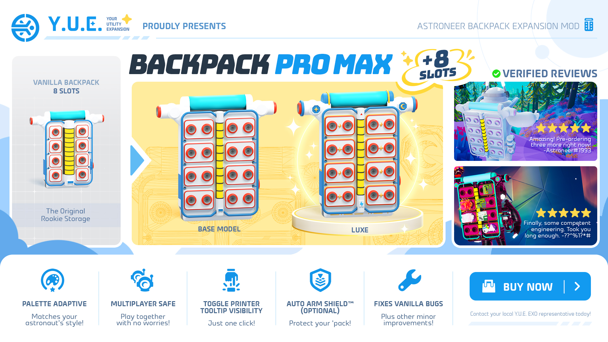
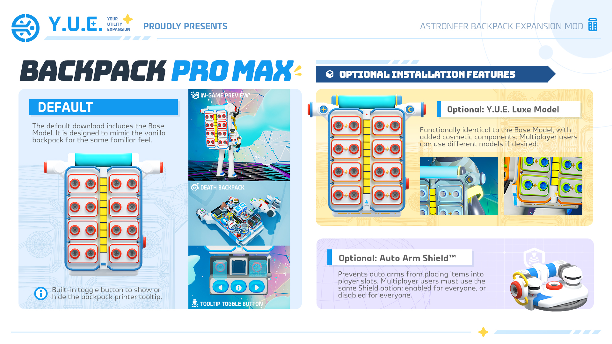

# 🎒 Backpack Pro Max 🎒

Spacefarers and Stargazers, behold your eyes upon the newly re-engineered backpack upgrade that introduces 8 additional slots on custom 3D models, brought to you by the Your Utility Expansion (Y.U.E.) team! Backpack Pro Max is not only multiplayer-safe, but also comes with new pre-packaged features like printer tooltip toggle, optional Auto Arm Shield™, and vanilla bug fixes.

Buy now! Contact your Y.U.E. EXO representative NOW to ensure your backpack is ready for the vast infinity of space exploration!

### Backpack Pro Max Specs:

✅ Fully functional additional 8 slots on backpack!  
✅ New custom 3D models that match your astronaut's palette!  
✅ Multiplayer safe!  
✅ 💥NEW!💥 Backpack printer button to toggle tooltip visibility!  
✅ Fixes bugs/issues with vanilla backpack!

### Optional feature:

✅ Auto Arm Shield™ 🛡️: Our patented astral-matrix material blocks pesky auto arms from placing unwanted stuff into all 16 Backpack Pro Max slots, shoulder auxiliary slots, terrain tool slots, or into items in your backpack that accept another item (e.g. galastropods, small generator, etc.).

### Model selection:

✅ Base model🛍️: New custom state-of-the-art 3D model that literally DOUBLES your backpack storage, while eco-friendly spacetime-compression technology also reduces polygons per print by 18%! Designed to echo the original design, the Backpack Pro Max is more capable and more sustainable while still being familiar to every ATP recruit!

✅ Y.U.E. Luxe✨: Is it functionally identical to the Backpack Pro Max base model? **Absolutely.** But does it feature 24-karat gold-dipped stars that are hand-aligned to your exact astrological ego by veteran Y.U.E. artisans? **100% YES!** Embrace your inner cosmic fashionista and revel in pure lunar majesty with Backpack Pro Max Luxe!

## Installation

Vortex and AstroModLoader-Classic installation recommended.

[Please see detailed installation guide here.](https://yuexr.github.io/astro/mods/installation/)

Please ensure only one variant of the mod is enabled.

**Multiplayer:** Please ensure all players have the same version installed. Host and guest must have the same Auto Arm Shield option, but can use different Base/Luxe models. Users will see their installed model for all players on the screen. Players retain their own backpack tooltip toggle preference.

## Detailed Feature List

  
Click for details: Backpack Pro Max ⤵️

- 8 additional backpack slots that retain same properties as regular backpack slots.
  - Items are scaled to 80% default backpack size when placed in main backpack slots to reduce clipping. Clipping still happens with larger items.
- Multiplayer compatible; all players must install the mod.
- Supports all item retrieval from player death backpacks.

  
Click for details: Printer Tooltip Toggle ⤵️

- Adds ℹ button in the middle of the backpack printer module.
  - Press to hide/show the output icon & tooltip. Includes sound effect.
  - When tooltip is hidden, hovering over output hologram still pulls up temporary tooltip.
  - Current selection preference is saved on computer across save sessions.
  - Multiplayer host and guests have own preferences.
  

  
Click for details: Auto Arm Shield (optional feature) ⤵️

- Stops auto arms from putting items into player slots, including:
  - Main backpack slots,
  - Shoulder auxiliary slots,
  - Terrain tool slots,
  - Equipment with input slots (e.g. galastropods, small generators, etc.).
- Items can still be fed into above-mentioned equipment manually, and equipment returns to normal behaviour when removed from backpack.

  
Click for details: Tweaks/Fixes to Vanilla ⤵️

- The following bugs/problems in vanilla have been patched in this mod:
  - Tiny printer hologram shows at bottom of backpack,
  - Incorrect start-up position research catalog,
  - Mission log does not consistently store away to intended skeleton,
  - (Creative Mode) Drone socket color does not change with palette,
  - (Creative Mode) Drone socket does not sit flush with backpack body, slightly floating.
  

  
Click for details: 3D Base Model ⤵️

- Base model aims to be true to the design of the original backpack.
  - Thinner battery modules to allow for more space for additional slots.
  - Wider socket pads to accommodate two sockets on each pad.
  - Wider backpack main face and outer tubing.
  - Optimized model geometry by removing hidden/redundant polygons, reducing triangles by 18%.
  

  
Click for details: 3D Luxe Model (optional feature) ⤵️

- Luxe model has additional mesh and materials added to the base model, including:
  - Oxygen tank casing: changed colour and added gold decorative tubing.
  - Shoulder auxiliary slots: added cuff to socket supports.
  - Shoulder auxiliary slot elbows: added recessed star & moon emblems that rotate with joint movement.
  - Socket pads: added gold border around each pad and star & diamond ornaments.
  - Battery casing: added standard Astroneer equipment "up" arrow to top casing, and glowing power accent to bottom casing.
  - Lower backpack shell: added gold morse code detail (YUE).
  - Back backpack shell: added gold stripe and Y.U.E. engraved text.
  - Materials: backpack face, power accent mount, and elbow emblem setting shells use different UV mapping. This is only noticeable with more detailed palettes.
- P.S. Luxe model was originally designed for myself with my personal preferences in mind, but I later decided to release publicly, so it may not be everyone's cup of tea.

## Known Issues & To-Do

**Mod-related:**

- Drone socket fix to vanilla implementation involves hiding the original drone socket visual and showing an adjusted copy instead. Can look into implementation where the original socket is targeted instead.

**Vanilla-related:**

- Research catalog panel resting position: metal edge of byte display clips out just a bit. Not sure if intentional in vanilla but I don't really like it, will consider fixing later.
- Shoulder auxiliary sockets are slightly visually offset from item attached, some clipping happening.
